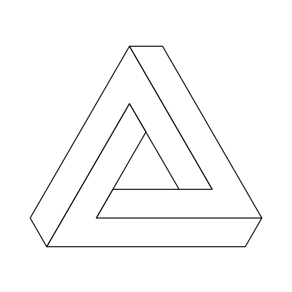

<div align="center">

# 🐍 Python Mini Project

**숫자로 배우는 반복문, 도형으로 만나는 착시**

구구단 출력과 Turtle 펜로즈 삼각형을 직접 구현한 Python 미니 프로젝트입니다.




*실제로는 만들 수 없지만, 그림 속에서는 이어지는 불가능 삼각형*

</div>

---

## ✨ 주요 기능

| 프로그램 | 설명 | 학습 내용 |
| --- | --- | --- |
| [구구단 출력](gugudan.py) | 입력한 정수의 구구단을 1부터 9까지 출력합니다. | 함수 · 입력 · 반복문 · 예외 처리 |
| [펜로즈 삼각형](penrose_triangle.py) | 세 가지 색의 면을 연결하여 입체적인 착시 도형을 그립니다. | Turtle · 좌표 · 다각형 · 회전 |

### 1. 원하는 구구단 출력하기

`몇 단을 입력할까요?`라는 질문에 정수를 입력하면 `gugudan(dan)` 함수가 구구단을 출력합니다. 숫자가 아닌 값을 입력하면 다시 입력할 수 있습니다.

```text
몇 단을 입력할까요? 7

[ 7단 ]
7 x 1 = 7
7 x 2 = 14
7 x 3 = 21
7 x 4 = 28
7 x 5 = 35
7 x 6 = 42
7 x 7 = 49
7 x 8 = 56
7 x 9 = 63
```

### 2. Turtle로 펜로즈 삼각형 그리기

펜로즈 삼각형은 세 막대가 서로 이어진 것처럼 보이는 **착시 도형**입니다. 하나의 다각형 면을 중심 기준으로 120°씩 회전하고 밝기가 다른 색으로 채워 입체감을 표현합니다.

- 어두운 배경과 청록색·하늘색·보라색의 세 면
- 좌표와 반복문으로 연결되는 정교한 모서리
- 별도 패키지 없이 Python 표준 라이브러리 사용

## 🚀 실행 방법

Python 3와 Turtle 창을 열 수 있는 데스크톱 환경이 필요합니다. `turtle`은 Tk 그래픽 기능을 사용합니다.

```bash
git clone https://github.com/sihoo1005/gugudan-and-turtle.git
cd gugudan-and-turtle
```

**구구단 실행**

```bash
python gugudan.py
```

**펜로즈 삼각형 실행**

```bash
python penrose_triangle.py
```

환경에 따라 `python` 대신 `python3` 또는 `py` 명령을 사용할 수 있습니다. Turtle 그림은 별도 창에 표시되며, 창 안을 클릭하면 닫힙니다.

## 📂 파일 구성

```text
gugudan-and-turtle/
├── README.md               # 프로젝트 소개 및 실행 방법
├── gugudan.py              # 구구단 출력 함수
├── penrose_triangle.py     # Turtle 펜로즈 삼각형
└── penrose_triangle.svg    # README 도형 미리보기
```

## 🎯 제작 목적

Python의 함수, 입력문, 반복문을 연습하고, 좌표와 회전을 이용해 그래픽으로 표현하는 방법을 익히기 위해 제작했습니다.

## 🔎 도형 참고

[Wikimedia Commons의 Penrose triangle.svg](https://commons.wikimedia.org/wiki/File:Penrose_triangle.svg)를 참고하여 Turtle 좌표와 회전 함수로 구성했습니다. 참고 도형은 퍼블릭 도메인으로 공개되어 있습니다.
